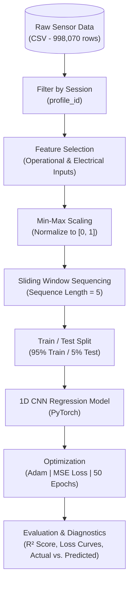
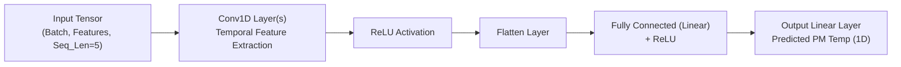

# ⚡ Electric Motor Temperature Prediction Using Deep Learning

[](https://www.python.org/)
[](https://pytorch.org/)
[](https://scikit-learn.org/)
[](https://www.kaggle.com/wkirgsn/electric-motor-temperature)

A deep learning regression pipeline built with **PyTorch** to predict **Permanent Magnet (`pm`) temperature** in Permanent Magnet Synchronous Motors (PMSMs) using time-series operational and sensor telemetry.

---

## 📌 Table of Contents
- [Project Overview](#-project-overview)
- [End-to-End Pipeline](#-end-to-end-pipeline)
- [Dataset Overview](#-dataset-overview)
- [Data Preprocessing](#-data-preprocessing)
- [Model Architecture](#-model-architecture)
- [Training Configuration](#-training-configuration)
- [Evaluation & Visualizations](#-evaluation--visualizations)
- [Installation & Usage](#-installation--usage)
- [Repository Structure](#-repository-structure)
- [Acknowledgments](#-acknowledgments)

---

## 🎯 Project Overview

Accurate thermal monitoring of electric motors is critical in **Electric Vehicles (EVs)** and industrial drive systems to:
* Prevent permanent magnet demagnetization and insulation degradation.
* Eliminate the need for expensive physical rotor temperature sensors.
* Enable real-time predictive maintenance and thermal derating strategies.

This project treats multi-sensor motor telemetry as sequential windows and leverages a **1D Convolutional Neural Network (CNN)** to capture short-term temporal dependencies and predict the target rotor/permanent magnet temperature.

---

## 🔄 End-to-End Pipeline



---

## 📊 Dataset Overview

The model is trained on the **Electric Motor Temperature Dataset** recorded from a test bench with a 52 kW PMSM sampled at **2 Hz**.

* **Source:** [Kaggle – Electric Motor Temperature](https://www.kaggle.com/wkirgsn/electric-motor-temperature)
* **Total Records:** `998,070` rows across multiple test sessions (`profile_id`)
* **Format:** `.csv`

### Feature Breakdown

| Feature | Description | Role |
| :--- | :--- | :--- |
| `ambient` | Ambient room temperature (°C) | Input Feature |
| `coolant` | Liquid coolant temperature (°C) | Input Feature |
| `motor_speed` | Rotational speed of the motor (rpm) | Input Feature |
| `torque` | Electromagnetic torque produced (Nm) | Input Feature |
| `u_d`, `u_q` | Voltage $d$- and $q$-axis components in DQ-frame (V) | Input Feature |
| `i_d`, `i_q` | Current $d$- and $q$-axis components in DQ-frame (A) | Input Feature |
| `stator_yoke` | Stator yoke temperature (°C) | Input / Auxiliary |
| `stator_tooth` | Stator tooth temperature (°C) | Input / Auxiliary |
| `stator_winding` | Stator winding temperature (°C) | Input / Auxiliary |
| `profile_id` | Unique identifier for each continuous measurement session | Session Filter |
| **`pm`** | **Permanent Magnet temperature (°C)** | **Target Variable** |

---

## ⚙️ Data Preprocessing

1. **Session Filtering:** Isolated specific measurement sessions via `profile_id` to preserve temporal continuity and prevent data leakage across disconnected test runs.
2. **Feature Normalization:** Applied `MinMaxScaler` to scale input features into a uniform `[0, 1]` range for stable gradient updates.
3. **Sequence Generation:** Transformed tabular rows into overlapping 3D tensors of shape `(Batch_Size, Features, Sequence_Length)` with a window size of **5 time steps**.
4. **Dataset Splitting:** Partitioned sequences into **95% training** and **5% testing** sets.

---

## 🧠 Model Architecture

The regression network uses 1D convolutions across the temporal axis to extract local trends in electrical and thermal signals before mapping them to a continuous temperature value.



* **Convolutional Layers (`Conv1d`):** Capture local rate-of-change patterns across consecutive sensor readings.
* **Activation Function (`ReLU`):** Introduces non-linearity to model complex electro-thermal interactions.
* **Fully Connected Layers (`Linear`):** Aggregates extracted temporal features into a scalar regression output.

---

## 🏋️ Training Configuration

| Hyperparameter | Value | Purpose |
| :--- | :--- | :--- |
| **Framework** | PyTorch | Model definition & autograd training loop |
| **Optimizer** | Adam | Adaptive learning rate optimization |
| **Loss Function** | Mean Squared Error (`MSELoss`) | Penalizes large temperature prediction errors |
| **Learning Rate** | `0.001` | Step size for parameter updates |
| **Epochs** | `50` | Full passes over the training sequences |
| **Sequence Length** | `5` | Historical time steps per prediction window |
| **Test Split** | `5%` | Held-out evaluation set |

---

## 📈 Evaluation & Visualizations

Model performance is validated quantitatively and visually inside the notebook:
1. **$R^2$ Score (Coefficient of Determination):** Quantifies how well predicted `pm` temperatures explain the variance in actual sensor measurements.
2. **Training vs. Validation Loss Curve:** Tracks `MSE` convergence across all 50 epochs to verify generalization and check for overfitting.
3. **Predicted vs. Actual Temperature Plot:** Compares predicted thermal trajectories against ground-truth readings over time.

---

## 🚀 Installation & Usage

### 1. Clone the Repository
```bash
git clone [https://github.com/](https://github.com/)<your-username>/<your-repo-name>.git
cd <your-repo-name>
```

### 2. Install Dependencies
```bash
pip install pandas numpy matplotlib seaborn torch scikit-learn
```

### 3. Download the Dataset
Download the dataset from [Kaggle](https://www.kaggle.com/wkirgsn/electric-motor-temperature) and place the `.csv` file in your working/data directory (update the file path in the notebook if needed).

### 4. Run the Notebook
Launch Jupyter and execute `cnn-motortemperature-regression.ipynb` sequentially:
```bash
jupyter notebook cnn-motortemperature-regression.ipynb
```

---

## 📁 Repository Structure

```text
├── cnn-motortemperature-regression.ipynb   # Main notebook: preprocessing, CNN model, training & plots
└── README.md                               # Project documentation
```

---

## 🙌 Acknowledgments

* **Dataset:** [Wilhelm Kirchgässner et al. – Electric Motor Temperature Dataset (Kaggle)](https://www.kaggle.com/wkirgsn/electric-motor-temperature)
* **Libraries:** [PyTorch](https://pytorch.org/), [Scikit-learn](https://scikit-learn.org/), [Pandas](https://pandas.pydata.org/), [Matplotlib](https://matplotlib.org/), and [Seaborn](https://seaborn.pydata.org/)
